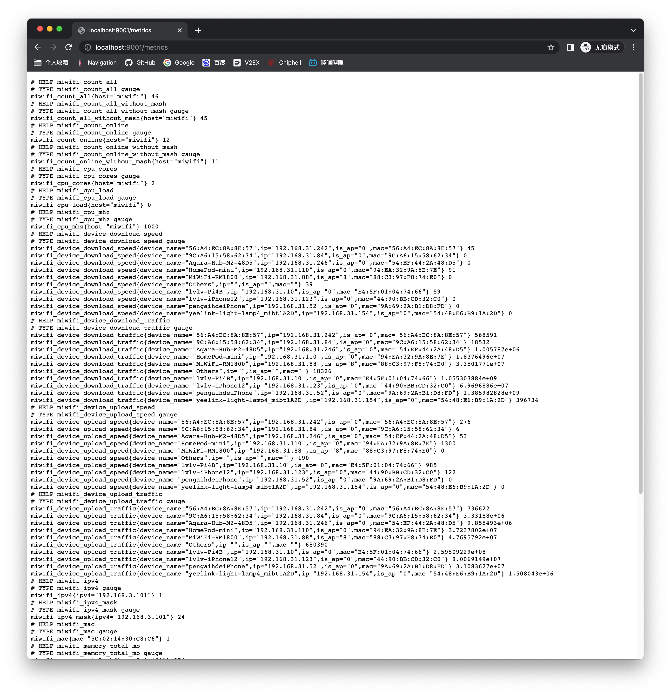
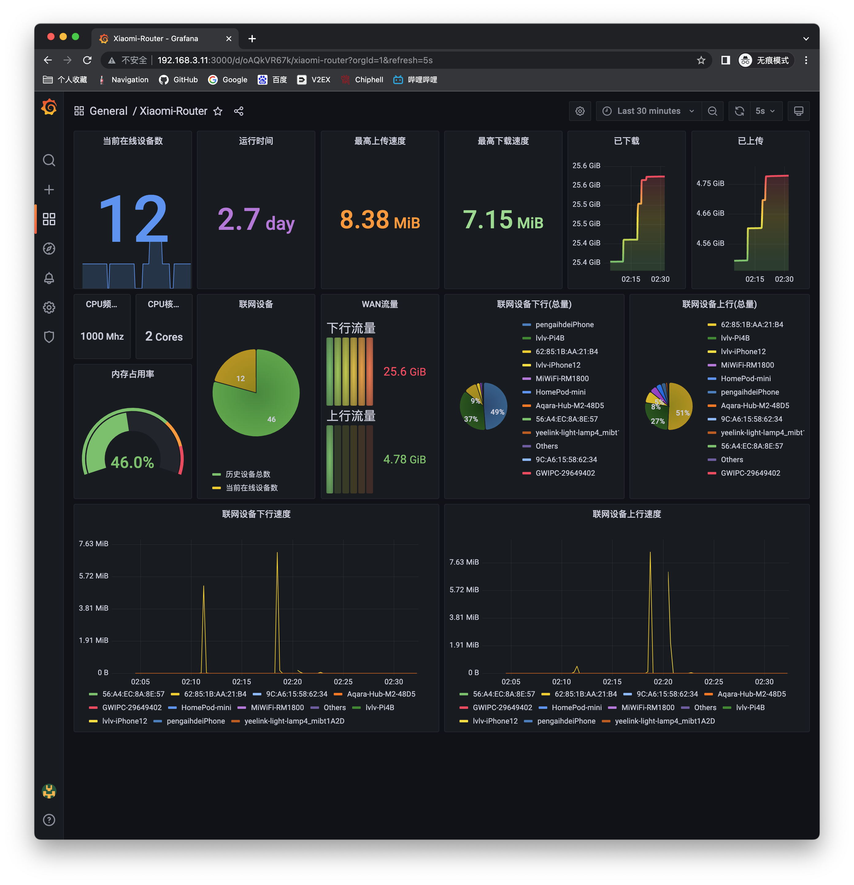

# miwifi_exporter

### Screenshot





### Usage

See ```docker-compose.yml```.

```shell
docker compose build
docker compose up -d
```

### Grafana dashboard

See  https://grafana.com/grafana/dashboards/16557-xiaomi-router/


### Collectors

| Name                      | Example                                                                                                                                                                                                                                                                       |
|---------------------------|-------------------------------------------------------------------------------------------------------------------------------------------------------------------------------------------------------------------------------------------------------------------------------|
| cpu_cores                 | miwifi_cpu_cores{host="Redmi-AX6S"} 2                                                                                                                                                                                                                                         |
| cpu_mhz                   | miwifi_cpu_mhz{host="Redmi-AX6S"} 1000                                                                                                                                                                                                                                        |
| cpu_load                  | miwifi_cpu_load{host="Redmi-AX6S"} 0 (This value always 0, 💩Xiaomi)                                                                                                                                                                                                          |
| memory_total_mb           | miwifi_memory_total_mb{host="Redmi-AX6S"} 256                                                                                                                                                                                                                                 |
| memory_usage_mb           | miwifi_memory_usage_mb{host="Redmi-AX6S"} 115.2                                                                                                                                                                                                                               |
| memory_usage              | miwifi_memory_usage{host="Redmi-AX6S"} 0.45                                                                                                                                                                                                                                   |
| count_all                 | miwifi_count_all{host="Redmi-AX6S"} 46                                                                                                                                                                                                                                        |
| count_online              | miwifi_count_online{host="Redmi-AX6S"} 12                                                                                                                                                                                                                                     |
| count_all_without_mash    | miwifi_count_all_without_mash{host="Redmi-AX6S"} 45 (I think it should be "mesh")                                                                                                                                                                                             |
| count_online_without_mash | miwifi_count_online_without_mash{host="Redmi-AX6S"} 11                                                                                                                                                                                                                        |
| uptime                    | miwifi_uptime{host="Redmi-AX6S"} 230035.3                                                                                                                                                                                                                                     |
| platform                  | miwifi_platform{platform="RB03"} 1                                                                                                                                                                                                                                            |
| version                   | miwifi_version{version="1.0.37"} 1                                                                                                                                                                                                                                            |
| sn                        | miwifi_sn{sn="xxx/xxxxx"} 1                                                                                                                                                                                                                                                   |
| mac                       | miwifi_mac{mac="5C:12:14:30:C8:C4"} 1                                                                                                                                                                                                                                         |
| ipv4                      | miwifi_ipv4{ipv4="192.168.3.101"} 1                                                                                                                                                                                                                                           |
| ipv4_mask                 | miwifi_ipv4_mask{ipv4="192.168.3.101"} 24                                                                                                                                                                                                                                     |
| ipv6                      | miwifi_ipv6{ipv6="2001:0db8:02de:0000:0000:0000:0000:0e13"} 1                                                                                                                                                                                                                 |
| wan_upload_speed          | miwifi_wan_upload_speed{host="Redmi-AX6S"} 2003                                                                                                                                                                                                                               |
| wan_download_speed        | miwifi_wan_download_speed{host="Redmi-AX6S"} 262                                                                                                                                                                                                                              |
| wan_upload_traffic        | miwifi_wan_upload_traffic{host="Redmi-AX6S"} 5.130555322e+09                                                                                                                                                                                                                  |
| wan_download_traffic      | miwifi_wan_download_traffic{host="Redmi-AX6S"} 2.7483196685e+10                                                                                                                                                                                                               |
| device_upload_traffic     | miwifi_device_upload_traffic{device_name="yeelink-light-lamp4_mibt1A2D",ip="192.168.31.154",is_ap="0",mac="54:48:E6:B9:1A:2D"} 1.519688e+06                                                                                                                                   |
| device_upload_speed       | miwifi_device_upload_speed{device_name="yeelink-light-lamp4_mibt1A2D",ip="192.168.31.154",is_ap="0",mac="54:48:E6:B9:1A:2D"} 0                                                                                                                                                |
| device_download_traffic   | miwifi_device_download_traffic{device_name="yeelink-light-lamp4_mibt1A2D",ip="192.168.31.154",is_ap="0",mac="54:48:E6:B9:1A:2D"} 400261                                                                                                                                       |
| device_download_speed     | miwifi_device_download_speed{device_name="yeelink-light-lamp4_mibt1A2D",ip="192.168.31.154",is_ap="0",mac="54:48:E6:B9:1A:2D"} 0                                                                                                                                              |
| wifi_detail               | miwifi_wifi_detail{band_list="20/40/80/160MHz",channel="48",ssid="XXX-5G-Game",status="1"} 1<br/> miwifi_wifi_detail{band_list="20/40/80MHz",channel="149",ssid="XXX-5G",status="1"} 1<br/>miwifi_wifi_detail{band_list="20/40MHz",channel="10",ssid="XXX-2.4G",status="1"} 1 |
| wifi_sta_count            | miwifi_wifi_sta_count{band="2.4GHz",host="miwifi"} 29<br/>miwifi_wifi_sta_count{band="5GHz",host="miwifi"} 10<br/>miwifi_wifi_sta_count{band="5GHz-high",host="miwifi"} 1 (各频段 WiFi 在线终端数)                                                                                                  |
| mesh_cap_count            | miwifi_mesh_cap_count{host="miwifi"} 0 (Mesh 主节点数)                                                                                                                                                                                                                         |
| mesh_re_count             | miwifi_mesh_re_count{host="miwifi"} 0 (Mesh 子节点数)                                                                                                                                                                                                                          |
| wan_link_status           | miwifi_wan_link_status{host="miwifi"} 2 (WAN 链路状态码，2=已连接)                                                                                                                                                                                                              |
| wan_negotiation_speed     | miwifi_wan_negotiation_speed{host="miwifi"} 10000 (WAN 协商速率，单位 Mbps)                                                                                                                                                                                                     |
| wan_info                  | miwifi_wan_info{dns="223.5.5.5,119.29.29.29",gateway="10.10.30.254",host="miwifi",wan_ip="10.10.30.249"} 1 (Info metric：外网 IP/网关/DNS)                                                                                                                                     |
| lan_port_link             | miwifi_lan_port_link{host="miwifi",port="0"} 0<br/>miwifi_lan_port_link{host="miwifi",port="1"} 1 (每个 LAN 口链路状态，0=断开，1=连接，索引即端口号)                                                                                                                           |
| lan_uptime                | miwifi_lan_uptime{host="miwifi"} 12676 (LAN uptime，单位秒)                                                                                                                                                                                                                    |
| wifi_device_signal        | miwifi_wifi_device_signal{band="2.4GHz",mac="64:9E:31:0F:80:97"} 90 (每台 WiFi 终端的信号强度，0-100)                                                                                                                                                                         |
| neighbor_wifi_rssi        | miwifi_neighbor_wifi_rssi{band="2g",bssid="02:95:51:C7:C1:93",channel="11",ssid="1201"} -60 (周围 WiFi 的 RSSI，单位 dBm，越接近 0 信号越强)                                                                                                                                   |
| neighbor_wifi_count       | miwifi_neighbor_wifi_count{host="miwifi"} 43 (周围扫描到的 WiFi 总数)                                                                                                                                                                                                          |
| device_wifi_quality       | miwifi_device_wifi_quality{device_name="ket ing",ip="192.168.31.131",mac="58:D3:49:25:57:F0"} 1 (设备 WiFi 信号等级，1-4)                                                                                                                                                     |
| device_connection_type    | miwifi_device_connection_type{device_name="ket ing",ip="192.168.31.131",mac="58:D3:49:25:57:F0",type="2"} 1 (Info metric：设备连接类型)                                                                                                                                        |
| device_pcontrol           | miwifi_device_pcontrol{device_name="ket ing",ip="192.168.31.131",mac="58:D3:49:25:57:F0"} 0 (设备是否启用家长控制，0/1)                                                                                                                                                       |

### Source Repo

https://github.com/HuckOps/miwifi_exporter